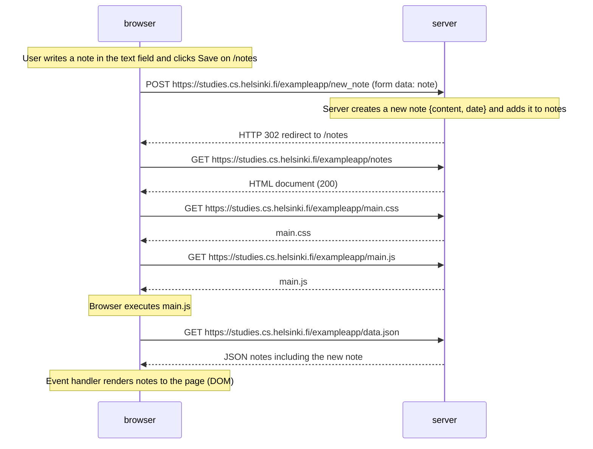

# Exercise 0.4: New note diagram

Diagram of the situation where the user creates a new note on the page https://studies.cs.helsinki.fi/exampleapp/notes using the traditional (non-SPA) version of the notes app.

Rendered image (PNG, drawn with PlantUML):

