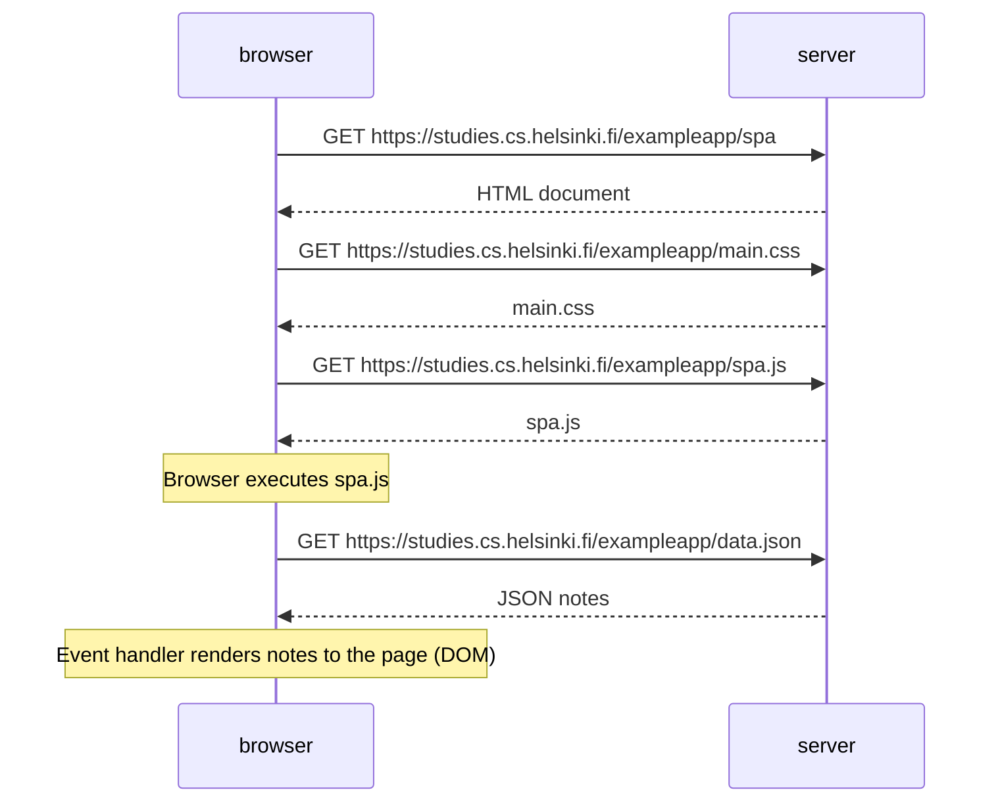

# Exercise 0.5: Single page app diagram

Diagram of the situation where the user goes to the single-page app version of the notes app at https://studies.cs.helsinki.fi/exampleapp/spa.

Rendered image (PNG, drawn with PlantUML):

