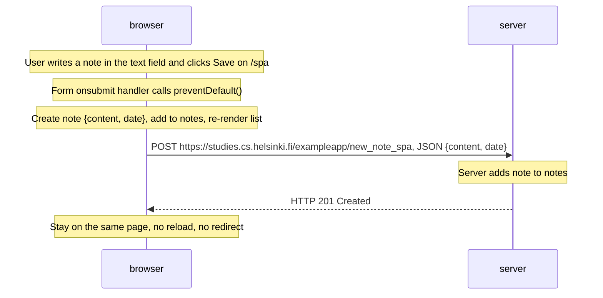

# Exercise 0.6: New note in a single-page app diagram

Diagram of the situation where the user creates a new note using the single-page version of the app at https://studies.cs.helsinki.fi/exampleapp/spa.

Rendered image (PNG, drawn with PlantUML):

